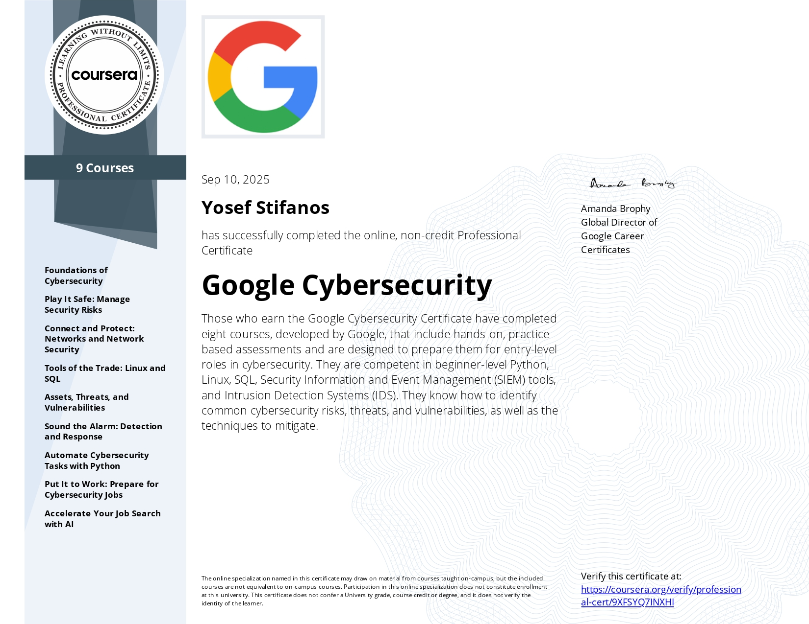

# Yosef Stifanos — Personal Website 🌐

Welcome to my personal website hosted at [yosefstifanos.github.io](https://yosefstifanos.github.io).
This site serves as a digital portfolio to highlight my background, resume, experience, and key projects in cybersecurity, GRC, and applied AI.

---

## 🧠 About Me

- I'm a Cybersecurity Engineer at **Caterpillar Inc.**, and a 2026 graduate of the University of Illinois Urbana-Champaign (B.S. in Information Sciences — Data Science & Cybersecurity concentrations).
- I'm passionate about offensive and defensive security, GRC & compliance automation, applied AI, soccer (Go Man United!), and building things that make an impact.

---

## 💼 Experience

- **Caterpillar Inc.** — Cybersecurity Engineer (Mar 2026 – Present). Compliance automation (OSCAL, ServiceNow IRM) and applied AI, including co-developing **BoM Squad**, a multi-agent AI system for automated Bill of Materials generation.
- **Freddie Mac** — Technology Analyst (May – Jul 2025). Enterprise resilience, cyber incident tabletop exercises, and attack path analysis reporting.
- **Grainger College of Engineering, UIUC** — Network & Infrastructure Engineering Student Consultant (Apr 2025 – Mar 2026).
- **Google (Mentor Me Collective)** — Cybersecurity Scholar (Aug – Dec 2025). Completed the Google Cybersecurity Professional Certificate.
- **Vivacity Tech PBC** — Software Quality Engineer Intern (Jan – Jun 2024).
- **UIUC Technology Services** — IT Operations Analyst (Sep 2022 – Feb 2025).

---

## 🎓 Education

**University of Illinois Urbana-Champaign**
B.S. in Information Sciences — Data Science & Cybersecurity (Aug 2022 – May 2026)
GPA 3.88/4.00 · 6x Dean's List · NSBE Chicago Scholarship Recipient

---

## 📄 Resume

You can view my resume directly at:
[📎 Yosef's Resume](https://yosefstifanos.github.io/Yosef_Resume_2026_Web.pdf)

---

## 🔬 Projects

### 🤖 BoM Squad
Multi-agent AI pipeline that converts engineering requirements into a draft Bill of Materials in minutes: PDF ingestion → Azure AI Search catalog research → automated BoM assembly → engineer-facing chatbot. Achieved 100%+ of project goals across all 7 deliverables; estimated $100k+/yr value per team and 15 hrs/week saved.
Technologies: `Python`, `Azure AI Search`, `Multi-Agent Systems`, `LLM`

### 🔐 [NIST Password Generator + Passphrase Tool](https://yosefstifanos.github.io/projects/NIST.html)
Generates strong, random passwords that meet NIST SP 800-63B guidelines, checks passwords against known breaches via the Have I Been Pwned API (k-anonymity), and generates secure Diceware-style passphrases.
Technologies: `HTML`, `CSS`, `JavaScript`, `Web Crypto API`, [Have I Been Pwned API](https://haveibeenpwned.com/API/v3#PwnedPasswords)

### 🏀 [March Madness ML Simulator](https://yosefstifanos.github.io/projects/mm26.html)
25 seasons of historical data, KenPom efficiency ratings, and Vegas lines fed into an ensemble model running 100,000 simulated tournaments to generate bracket picks with win probabilities.
Technologies: `Python`, `Scikit-learn`, `Monte Carlo`

### 📋 OSCAL Compliance Automation
End-to-end compliance data pipeline integrating OSCAL-formatted control data with ServiceNow IRM transform maps and Snowflake.
Technologies: `OSCAL`, `ServiceNow IRM`, `NIST RMF`

### ✝️ [Concordia](https://yosefstifanos.github.io/projects/concordia.html)
An LCMS confessional study assistant grounded in the Book of Concord and Luther's writings, with live web verification against current LCMS/CTCR positions and built-in debate prep across Christian traditions.
Technologies: `Claude API`, `Web Search Tool`, `Book of Concord`

### ⚽ [Red Resilience](https://yosefstifanos.github.io/projects/red_resilience_website.html)
An interactive longform feature on Manchester United's 2024/25 season, exploring resilience and loyalty through scroll-triggered reveal animations, key stats, and fan voices.
Technologies: `HTML`, `CSS`, `JavaScript`, `Scroll Animation`

### 🎮 [Game Sales Prediction & Playtime Classification](https://github.com/yosefstifanos/final_project)
Regression and classification models forecasting video game sales and playtime behavior, evaluated with R², RMSE, and AUC.
Technologies: `Python`, `Scikit-learn`, `Statsmodels`, `Jupyter Notebooks`

---

## 🏅 Certification

**Google Cybersecurity Professional Certificate**
Coursera · 9 Courses · Completed Sep 10, 2025
Foundations · SIEM · Network Security · Linux · Python Automation · IDS · Incident Response

[View Certificate](https://coursera.org/share/f9bf6647320fe57074c391169d92f173)

---

## 🛠️ Tech Stack

**Languages:** Python, JavaScript, SQL, HTML, CSS, Java
**Offensive:** Kali Linux, NMAP, Wireshark, Burp Suite, MITRE ATT&CK, CTF / SIGPwny
**Defensive:** Splunk, SIEM, IDS/IPS, Incident Response, Threat Detection
**GRC:** OSCAL, NIST RMF, ServiceNow IRM, Snowflake, Vulnerability Assessment
**AI & Data:** Azure AI Search, Multi-Agent LLM systems, Pandas, Scikit-learn, NumPy, Matplotlib
**Platforms:** Power BI, Git/Jira, IPAM, Linux, Windows, MySQL, MongoDB

---

## ✨ Site Features

- Apple-inspired design system with soft gradient sections, scroll-aware nav, and section-highlighting.
- Light/dark theme toggle (🌗) in the nav.
- A small animated panda easter egg that wanders the page, reacts to scrolling, and can be clicked to duck into a bamboo hideout (and takes naps in dark mode 🌙).

---

## 🚀 Visit the Site

Check out the live site here:
👉 **[yosefstifanos.github.io](https://yosefstifanos.github.io)**

---

Feel free to connect on [LinkedIn](https://www.linkedin.com/in/yosefstifanos) or reach out at yosefstifanos30@gmail.com! I am always looking to improve my website, so please help me out with cool ideas!!!